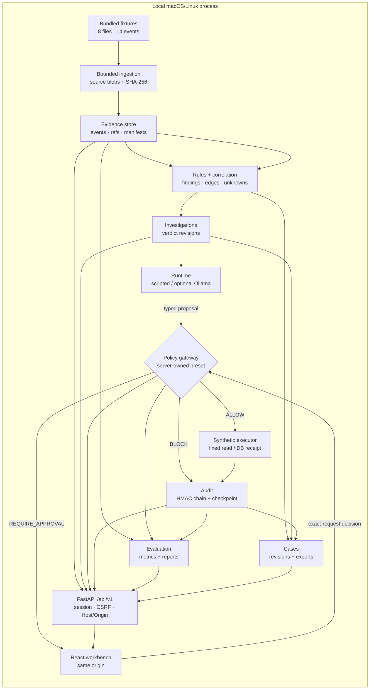

# Agent Security Workbench architecture

Status: **implemented local MVP**, 2026-10-20. This document describes the code in `agentguard/workbench/` and `frontend/`, not a target design. Historical AgentGuard behaviour and the reasons for rebuilding its unsafe boundaries are preserved in [BASELINE_AUDIT.md](BASELINE_AUDIT.md). Measured verification is in [VALIDATION.md](VALIDATION.md); threats and assurance limits are in [THREAT_MODEL.md](THREAT_MODEL.md).

## Purpose and deployment boundary

One local application makes this workflow inspectable:

**Synthetic telemetry → immutable evidence → deterministic findings → analyst investigation → typed tool proposal → server policy → optional human approval → synthetic execution → HMAC audit → scoped case → evaluation**

The evaluator measures the pipeline against authored expectations. It does not feed labels into detection or authorization.

The deployment is deliberately narrow:

- One FastAPI process serves the built React assets and `/api/v1` at `http://127.0.0.1:8765`.
- SQLite is the only datastore. There is no broker, external database, cloud model, remote identity provider or background worker.
- The default runtime is deterministic and scripted. Optional Ollama is operator-enabled, loopback-only and disabled in every test.
- Effects are a fixed read of synthetic text or one row in local SQLite. No external write, shell, arbitrary file read, secret read or network effect exists.
- One local operator session is supported. This is not multi-user RBAC or a verified human identity.

## Implemented architecture



The runtime is not the decision-maker. A finding can supply context to a run, but does not itself start an agent, grant a permission or authorize a tool. The proposal crosses the gateway only as untrusted input.

## Module inventory

| Module | Responsibility |
|---|---|
| `settings.py` | Frozen runtime configuration and loopback defaults |
| `util.py` | Canonical JSON, hashes, UTC helpers, bounded constants |
| `db.py` | SQLite connection policy, checksummed migration, `BEGIN IMMEDIATE` unit of work |
| `migrations/001_initial.sql` | Schema version 1 |
| `evidence.py` | Bounded fixture collection, parsing, source snapshots, exact evidence resolution |
| `detection.py` | Versioned rules, correlation edges, finding evidence, uncertainty |
| `findings.py` | Finding/evidence/timeline read models |
| `investigations.py` | Investigation creation and append-only verdict revisions |
| `policy.py` | Trusted tool registry, presets semantics, allowlists, resource/request digests |
| `enforcement.py` | Proposal insertion, approval state machine, idempotency, synthetic execution, cancellation, policy change |
| `audit.py` | HMAC chain, key handling, transactional append, integrity/completeness/consistency verification |
| `runtime.py` | Four scripted scenarios; optional loopback Ollama adapter |
| `bootstrap.py` | Idempotent local dataset import and detection |
| `sessions.py` | Opaque session tokens, CSRF values, bootstrap codes |
| `overview.py` | Scoped counts, attention, coverage and short activity feed |
| `cases.py` | Scoped case creation, immutable revisions, escaped exports |
| `evaluation.py` | Evaluation runs, result categories, metrics, report generation |
| `metrics.py` | TP/FP/TN/FN, abstention/missing/error buckets, undefined-metric handling |
| `api.py` | FastAPI routes, middleware, DTOs, session/CSRF dependencies, SPA serving |

The frontend is a React 19 + TypeScript application:

| Area | Responsibility |
|---|---|
| `api/client.ts` | Same-origin fetch, CSRF header, `Idempotency-Key`, typed errors/aborts |
| `state/SessionContext.tsx` | Bootstrap exchange and session recovery |
| `state/WorkspaceContext.tsx` | Persisted dataset/timezone selection |
| `components/Layout.tsx`, `ui.tsx` | Skip link, nav landmarks, scope bar, tables, dialogs, status labels |
| `pages/*` | Six primary screens and detail routes |
| `styles.css` | Responsive investigation-desk layout, no external fonts/CDN |

## Persistence and transactions

SQLite runs with:

- `PRAGMA foreign_keys = ON`
- `busy_timeout = 5000`
- rollback journal (`journal_mode = DELETE`) and `synchronous = FULL`
- one connection per unit of work
- explicit `BEGIN IMMEDIATE` for mutations
- a migration checksum recorded in `schema_migrations`; an unknown future version or changed migration fails startup

Runtime directory mode is `0700`; the database and audit key are set to `0600` where the platform permits it. The audit key is created with `O_EXCL`/`O_NOFOLLOW` where available and a random 32-byte value.

The schema is one numbered migration. Main table groups:

| Group | Tables |
|---|---|
| Dataset and evidence | `datasets`, `source_blobs`, `events` |
| Detection | `detection_runs`, `findings`, `finding_evidence`, `correlation_edges` |
| Analyst work | `investigations`, `verdict_revisions` |
| Runtime | `runs`, `trace_events` |
| Authorization | `policy_presets`, `tool_requests`, `approvals`, `execution_results`, `simulated_receipts` |
| Browser session | `sessions` |
| Replay protection | `idempotency_records` |
| Audit | `audit_events`, `audit_state` |
| Cases | `cases`, `case_revisions`, `case_exports` |
| Evaluation | `evaluation_runs`, `evaluation_results` |

IDs are opaque server-generated strings. Timestamps are UTC ISO-8601 with `Z`; `events` retains the original source timestamp separately. Canonical JSON uses sorted keys, compact separators, UTF-8 and rejects `NaN`.

Synthetic source bytes and receipts live **inside SQLite**. This keeps evidence, approval consumption, execution result, trace and audit append in one commit. Downloaded reports are derived artifacts, not authoritative state.

## Ingestion and detection

The bundled dataset is fixed; the browser cannot supply a filesystem path, URL or upload. `collect_dataset` enforces these configured limits:

| Limit | Value |
|---|---|
| Source bytes | 10 MiB |
| Dataset bytes | 50 MiB |
| Records | 100,000 |
| Line bytes | 64 KiB |
| JSON depth | 20 |

Collection rejects missing required sources, symlinks, paths outside the fixture root, invalid UTF-8, NUL bytes, duplicate JSON keys, non-finite numbers and structurally invalid records. Optional note content is stored as inert text. The contract test that an optional note is inert is `test_optional_untrusted_note_is_stored_as_inert_text`.

The sample has eight files and 14 events from Zeek, Suricata, Windows and an agent-action trace. Each event stores `(source_id, line_no)` uniquely, a raw SHA-256 and a parser status. Evidence resolution re-reads the captured blob, checks its hash and returns the exact line; a changed/missing snapshot becomes an explicit integrity error, not a fresh read of the filename.

Detection is deterministic and versioned (`rules-2026.10.1`). It emits:

- findings with disposition `REVIEW`, `LOW` or `UNKNOWN`;
- explicit observed/supporting/contradicting facts and unknowns;
- exact event IDs plus correlation edges;
- join fields, time delta, window and an attribution limitation;
- an explainable rule priority, not a probability.

The shared-host scenario uses a default 60-second correlation window; the Build network join uses 30 seconds. All findings with a host-only relationship call it `host_association`/`time_proximity_host_association`; IP proximity is never promoted to confirmed agent ownership. Missing telemetry is visible as coverage loss.

## Authorization and approval

### Tool registry

| Tool | Preset result | Effect |
|---|---|---|
| `read_report` | `ALLOW` in all presets | Returns fixed synthetic report text; no file/network access |
| `publish_simulated` | `BLOCK` in Deny, `REQUIRE_APPROVAL` in Approve, `ALLOW` in Monitor | Inserts at most one local synthetic receipt row |
| `read_secret` | `BLOCK` in all presets | No implementation exists |
| Unknown tool | `BLOCK` | No implementation exists |

The server loads `policy_presets` (`deny-v1`, `approve-v1`, `monitor-v1`). A request can select a preset when starting a run, but it cannot select the mode inside a proposal. The proposal's actor is server-supplied by the runtime adapter. Source fields such as `approved: true` are inert evidence.

Tool arguments are checked by exact key set, string type, length and enumerated value. Request binding includes schema, request ID, run, actor, tool/schema version, normalized arguments, resource reference/hash, policy preset/version and expiry. The SHA-256 request digest is stored immutably.

### Decision and execution states

Authorization (`ALLOW`, `BLOCK`, `REQUIRE_APPROVAL`), approval (`PENDING`, `REJECTED`, `EXPIRED`, `INVALIDATED`, `CONSUMED`) and execution (`NOT_STARTED`, `SUCCEEDED`, `FAILED`) are separate fields. The UI does not treat "Approved once" as an execution result.

Allowed approval transitions are:

```text
PENDING → CONSUMED | REJECTED | EXPIRED | INVALIDATED
```

Terminal states never return to pending. Run cancellation and policy changes invalidate pending approvals in the same transaction. Any changed argument, resource hash, policy version or request digest requires a new proposal.

### Transactional approval

```mermaid
sequenceDiagram
  participant R as Scripted/Ollama runtime
  participant G as Gateway
  participant DB as SQLite BEGIN IMMEDIATE
  participant O as Local operator
  R->>G: propose(tool, validated-shape args)
  G->>DB: load run + immutable preset
  G->>DB: insert request snapshot + decision + trace + audit
  DB-->>O: pending request, digest, exact effect, expiry
  O->>G: approve/reject + digest + version + reason + idempotency key
  G->>DB: reload request, verify session/digest/version/expiry/policy/resource
  G->>DB: conditional PENDING update; receipt/result/idempotency/audit
  DB-->>G: one commit or rollback
  G-->>O: decision + separate execution result
```

`decide_approval` runs inside `BEGIN IMMEDIATE` and:

1. verifies the local session;
2. checks an idempotency record before state mutation;
3. reloads the approval, request and run;
4. enforces session ownership and `PENDING` state;
5. checks server time against expiry;
6. compares the reviewed digest and expected version;
7. rechecks the current policy and resource hash;
8. conditionally updates `WHERE state='PENDING' AND expected_version=…`;
9. creates the synthetic result, trace and audit event;
10. stores the idempotency response and commits.

A second decision with a different idempotency key receives `409`; an identical replay returns the stored response. Race tests use both threads and separate OS processes, with one committed receipt and one conflicting decision. Separate OS processes also exercise the approval race. Write-failure injection and a process exit after the synthetic effect but before commit verify rollback and recovery; they do not simulate power loss.

## Audit

Mutating services check audit health, and every `append_audit` independently verifies it inside an explicit transaction. An unhealthy chain blocks mutations with HTTP 503 `AUDIT_INTEGRITY_FAILED`. Verification is read-only and never repairs the chain.

`verify_audit` returns:

| Claim | Values | Meaning |
|---|---|---|
| `integrity` | `valid`, `invalid`, `unverifiable` | Retained HMAC chain and key checks |
| `completeness` | `unanchored`, `checkpoint_matched`, `checkpoint_mismatch` | Relationship to the local head checkpoint |
| `consistency` | `ok`, `failed`, `unknown` | Event/checkpoint and key consistency |
| `safe_for_mutations` | boolean | Gate used by mutating services |

Empty history with a non-empty checkpoint fails closed. Deleting a suffix or the whole event table leaves the retained prefix valid but yields `checkpoint_mismatch` and `safe_for_mutations=false`. Missing, symlinked or group-readable keys are `unverifiable`. The message explicitly says this is **not independent tamper-proof storage**.

Audit payloads contain IDs, decision/reason codes, argument digests, policy version, result hash and correlation metadata. They do not contain raw tool arguments; `test_audit_does_not_store_raw_tool_arguments` checks the allowlisted values are absent. Local host administrators can still replace the database, key and checkpoint.

## API and browser security

All API reads require a local session. The only unauthenticated API exception is:

```text
POST /api/v1/session/exchange
```

The startup terminal prints a grouped 64-bit bootstrap code (16 hex characters) with a five-attempt limit. It is single-use and expires after 10 minutes. Exchange requires exact Host and Origin, JSON, a bounded body and the code. The response sets an HttpOnly, SameSite=Strict cookie (loopback HTTP, so `Secure` is not set) and returns a CSRF token used by mutations. The client keeps the CSRF token in memory and `sessionStorage`, not in a URL or local storage.

Every mutation requires:

- a valid session cookie;
- `X-CSRF-Token` matching the session value with constant-time comparison;
- exact `Origin` in `http://127.0.0.1:8765` / `http://localhost:8765` (or the configured port);
- `Sec-Fetch-Site` absent or `same-origin`/`none`;
- `Content-Type: application/json` (bodyless mutations send `{}`);
- a body no larger than 64 KiB, UTF-8, one JSON object, no duplicate keys.

Responses carry `X-Request-ID`, `nosniff`, `no-referrer`, `DENY` framing, `same-origin` resource policy, a CSP blocking inline scripts and arbitrary inline styles; one exact hash permits WebKit’s native `text-overflow:inherit` attribute, and `no-store`. CORS is not enabled. Unknown `/api` paths return a JSON error, not the SPA.

The SPA is served by the backend with an `index.html` fallback; production assets are mounted under `/assets`. Vite is a development-only server with an `/api` proxy and is not a deployment target.

## Runtime

`runtime.py` exposes four scripted scenarios:

| Scenario | Visible behaviour |
|---|---|
| `normal` | Safe fixed report read |
| `injection` | A scripted follower acts on an untrusted note and proposes a simulated publish |
| `overreach` | Proposes forbidden secret read, then simulated publish |
| `boundary_aware` | Labels the note untrusted and emits an explicit `NO_TOOL_CALL` |

No scripted path reads `untrusted_note.txt` as an instruction; the text is inert evidence and the scenario is a deterministic policy test. This is not an LLM susceptibility measurement.

The optional Ollama path:

- requires `AGENTGUARD_ENABLE_OLLAMA=1`;
- accepts only an unauthenticated loopback HTTP endpoint;
- disables proxies and redirects;
- uses at most 3 turns and 8 proposals, a 120-second request timeout and a 2 MiB response cap;
- validates message/tool-call shapes and records visible messages only;
- sends tool results back as data and gives the model no approval capability.

The adapter exists but **no real model run was performed**. Offline transport tests in `tests/test_runtime_adapter.py` cover malformed/oversized responses, no-call, policy modes, budgets, outages, redirect refusal and endpoint validation. Failed connections are attempted runs, not observed responses. Runtime version and model digest remain explicitly unknown. Legacy mocks are separate.

## Cases and evaluation

Cases are explicit analyst records, distinct from findings. A case revision stores selected finding IDs, optional investigation ID, selected request IDs, summary, scope, conclusion and recommendations. Revision appends use optimistic `expected_revision`; stale writes return 409. Exports are:

- Markdown with escaped table/HTML-sensitive characters;
- JSON with content schema and hashes;
- CSV with formula-prefix neutralization.

An export is written only after evidence hashes resolve. It embeds a verification snapshot and `integration_status=manual_export_only`; no external delivery is implied.

Evaluation runs only the deterministic scripted suite. Results are categorized as `synthetic_detection`, `scripted_enforcement` and `local_model_observations`. The first two are stored as individual `evaluation_results`; local-model counts distinguish attempted runs from runs with a validated response, within the selected dataset, and are explicitly excluded from metrics. Metrics preserve `abstained`, `missing`, `errored`, `unlabeled`, `coverage` and conditional precision/recall; F1 is `null` when a required metric is undefined and `0.0` for a defined zero/zero case.

Unknown-time case evidence is retained outside the ordered timeline. Reports are written to `run/reports/` for the default app or `<out>/reports/` for `make eval`. The API export route sets `.json`, `.md` and `.csv` filenames and is checked by both backend tests and the browser workflow.

## Frontend composition and states

The six primary screens are Overview, Investigations, Agent traces, Policy & approvals, Evaluation and Audit & cases. Detail routes cover findings, evidence, investigations, runs, approvals, evaluations and cases. Navigation and the scope bar are landmarks; the skip link targets a focusable main region.

Every data view uses a shared `useApi` hook with loading, ready, empty and error states. Mutations do not optimistically show success: the UI waits for the server response, surfaces typed error codes and reloads current state where required. Evidence payloads are rendered as text, never HTML. The responsive layout keeps the sidebar at 1024px, collapses navigation to a horizontal bar at 390px and avoids horizontal page overflow.

## Bounded values

| Setting | Default |
|---|---|
| Approval TTL | 10 minutes |
| Session TTL | 8 hours |
| Bootstrap TTL | 10 minutes / 5 attempts |
| Request body | 64 KiB |
| Source / dataset / records | 10 MiB / 50 MiB / 100,000 |
| Source line / JSON depth | 64 KiB / 20 |
| Model turns / proposals | 3 / 8 |
| Model response | 2 MiB, 120 s timeout |

These are enforced limits, not measured capacity guarantees. No load test at the maximum record count was run.

## Deliberately unsupported

Real executors, shell, arbitrary filesystem/network tools, secret reads, external case writes, remote deployment, multi-user RBAC, external identity, background queue, distributed transactions, independent audit storage, real packet capture, LogLM/cloud-model integration and production isolation are absent. Adding any of them requires a new design and recovery/authorization tests; the current local transaction guarantee does not transfer.

## Continuation hardening

Approval decisions recompute the stored request binding and current policy semantics before consuming approval. Idempotency includes approval identity, and the gateway enforces eight proposals independently of adapters. JSON is bounded by size, nesting, finite numbers and valid Unicode. Descriptor-based source reads refuse symlinks and bound bytes. Parsed timestamps retain fractions; missing or timezone-free values remain unknown. UI resources are keyed by request path so a failed navigation cannot display an earlier record. See ADR-011–ADR-014 for the observed reasons.
